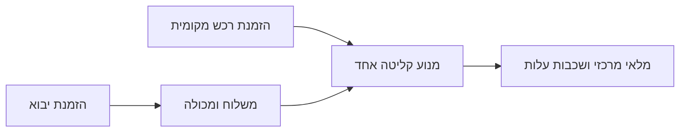

# I1 — ארכיטקטורת יעד

## עקרון

הזמנה אינה מלאי. כמות המוצר עולה רק אחרי קליטה פיזית שאושרה והצליחה בטרנזקציה אחת.

רכש מקומי ויבוא נשארים מסמכים מסחריים נפרדים. שניהם נקלטים לאותו מלאי. אין מנוע מלאי נפרד לצמיגים מיובאים.

## שלושה מצבים בלתי תלויים

לכל הזמנת יבוא יש שלושה צירים. אף אחד מהם אינו נגזר אוטומטית מהאחר:

| ציר | מה הוא מתאר | מה הוא אינו עושה |
|---|---|---|
| מסחרי | טיוטה, אישור תנאים, תשלומי ספק | אינו משנה מלאי |
| לוגיסטי | משלוחים, מכולות, אבני דרך ותאריכים | אינו פותח קליטה לבד |
| קליטה | טיוטות קבלה ואישורים אטומיים | אינו משנה את תנאי המחיר שסוכמו |

שינוי סטטוס בממשק אינו פותח קליטה. הפעולה "התחלת קליטה" זמינה רק כשהשרת מאשר שהמשלוח הגיע למחסן, או שהזמנת הרכש המקומית במצב שממתין לקליטה.

## הזמנה, משלוח ומכולה

הזמנת יבוא נשארת המסמך המסחרי מול ספק אחד. אפשר כמה הזמנות פעילות לאותו ספק.

משלוח הוא תנועה פיזית. מכולה אחת יכולה לשאת שורות מכמה הזמנות. ההזמנות אינן ממוזגות. שורת המשלוח מצביעה לשורת הזמנה ולכמות שבמכולה.

הזמנת רכש מקומית אינה חייבת משלוח ימי. היא נכנסת לאותו מנוע קליטה ישירות מההזמנה.

## מנוע קליטה משותף

יעד אחד, שני מקורות:

- `source_type = import_shipment_line` או `import_order_item` עד שקיים משלוח
- `source_type = purchase_order_line`

המנוע העתידי מחליף, אחרי אישור נפרד, את `import_receipt_confirm` ואת `post_purchase_receipt`. עד אז נשארת הקליטה החיה של היבוא, וקליטת הרכש נשארת בלי הרשאת הרצה.

דרישות המנוע:

- בדיקת חברות וחיוב לפני כל קריאה
- מפתח אידמפוטנטיות
- נעילת השורות
- דחיית קבלה שכבר אושרה
- עדכון כמות, תנועת מלאי ושכבת עלות באותה טרנזקציה
- טיוטה בלי נגיעה ב־`products.quantity`
- אין כתיבת מלאי מהדפדפן
- כמות שהתקבלה, כמות פגומה וכמות חסרה אינן נספרות פעמיים
- מלאי פגום או בהסגר נשמר בנפרד מהמלאי הנמכר

## שכבות עלות

היום `products.cost` הוא ממוצע נע יחיד. `inventory_actions.cost_snapshot_ils` שומר את עלות המכירה בזמן המכירה. `reports_aggregate` משתמש בתמונת המכירה, לא בעלות הנוכחית.

שכבות FIFO בקובץ הלא־מוחל הן לפי עסק ומוצר, בלי סניף. מקור עתידי של קליטת יבוא צריך להצטרף לאותה טבלה, לא לטבלת לוטים נפרדת. עד אישור FIFO, קליטה חדשה אינה מופעלת ואינה ממציאה תאריך קבלה למלאי קיים.

התאמת עלות אחרי קליטה נכתבת כשכבה או כתנועת התאמה חדשה. היא אינה דורסת את `purchase_unit_ils` של הקליטה המקורית ואת `cost_snapshot_ils` של מכירות עבר.

## סניפים

אין מודל סניף בקוד או בסכמה שנבדקה. הבידוד הקיים הוא עסק. I2 אינו ממציא סניפים. אם יוחלט על סניפים, זו החלטת מוצר נפרדת לפני הוספת `branch_id`.

## גבולות שלא זזים בשלב הזה

- דגלי הרכש והקליטה נשארים כבויים
- אין הפעלת FIFO
- אין החלפת `import_receipt_confirm`
- ממשק V2 נשאר כבוי כברירת מחדל
- היישום הישן ב־`/import` ממשיך לשרת את ההזמנות הקיימות עד שלב החלפה מאושר
